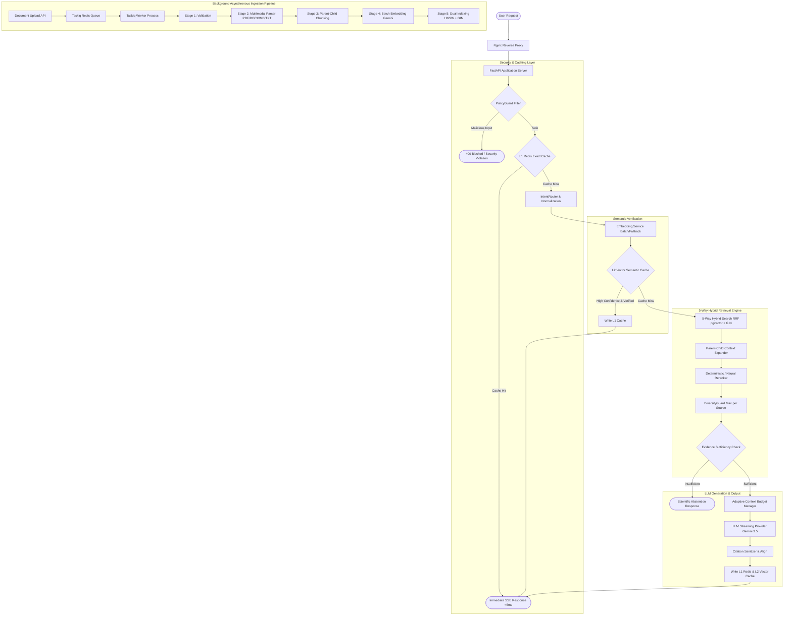

# Generalized Production-Grade RAG Blueprint
### المعمارية المرجعية المتقدمة لنظم الاسترجاع المعزز بالتوليد (Production RAG)

[](https://www.python.org/)
[](https://fastapi.tiangolo.com/)
[](https://github.com/pgvector/pgvector)
[](https://redis.io/)
[](https://taskiq-python.github.io/)
[](https://opensource.org/licenses/MIT)

---

<div dir="rtl" style="text-align: right; direction: rtl;">

## 📖 نظرة عامة على المشروع (Project Overview)

هذا المشروع يمثل **المخطط المعماري المرجعي الموحد (Production RAG Blueprint)** للأنظمة الإنتاجية المتقدمة المبنية على تقنيات استرجاع المعلومات المعززة بالتوليد (Retrieval-Augmented Generation). تم تصميم وبناء هذه المنظومة بالكامل وفق أرقى معايير هندسة البرمجيات المؤسسية (**Enterprise Clean Architecture**) مع الالتزام الصارم بمبادئ **SOLID**, **DRY**, **KISS**, و **Fail-Safe Defense-in-Depth**.

النظام غير مقيد بمجال عمل محدد (**Domain-Agnostic**) ويدعم مختلف اللغات الطبيعية (العربية، الإنجليزية، الإسبانية، البرتغالية) مع معالجة بنيوية فائقة الدقة للوثائق النصية وملفات PDF و DOCX و Markdown.

---

### 🌟 أبرز الخصائص والقدرات المعمارية (Key Architectural Pillars)

1. **محرك الاسترجاع الهجين الخماسي (5-Way Hybrid Retrieval with RRF):**
   - استرجاع دلالي متجهي عبر خوارزمية **HNSW Cosine** في PostgreSQL 16 + pgvector.
   - استرجاع معجمي ولغوي كامل عبر فهارس **GIN** مع محلل الصرف والتجريد (`arabic_unaccent`, `english_stem`).
   - استرجاع ثلاثي الأحرف (**Trigram**) للأخطاء الإملائية واسترجاع مطابق للعناوين والمسارات الهيكلية.
   - دمج الرتب عبر خوارزمية **Reciprocal Rank Fusion (RRF)** مع مرشح تنوع المصادر (**DiversityGuard**).

2. **منظومة الكاش الدلالي الموزع ثنائي الطبقات (Two-Tier Distributed Semantic Cache):**
   - **الطبقة الأولى (L1 Redis Cache):** فحص فوري للتطابق التام للطلبات في زمن استجابة يقل عن 5 مللي ثانية.
   - **الطبقة الثانية (L2 Vector Semantic Cache):** مطابقة دلالية متجهية في pgvector مدعومة بنظام التحقق من التكافؤ الاستفهامي (**Equivalence Verifier**).
   - قفل الحماية من انهيار الكاش (**Single-Flight Mutex / Distributed Lock**) لمنع تكرار استدعاءات النماذج لنفس الاستفسار المتزامن.

3. **هندسة السياق والحماية الصارمة (Context Engineering & Policy Guard):**
   - مصنف نوايا المستخدم التفاعلي (**IntentRouter**) لكشف الاستفسارات الجديدة والمتابعة والتوضيح.
   - جدار حماية حتمي فائق السرعة (**PolicyGuard**) يكتشف ويحجب محاولات حقن التوجيهات (**Prompt Injection**)، كسر القيود (**Jailbreak**)، وحقن الاستعلامات البرمجية (**SQL / XSS**) في أقل من مللي ثانية واحدة.
   - إدارة ميزانية الرموز التكيفية (**Adaptive Token Budgeting**) وضغط السياق متعدد الأدوار بدون ضياع للمعلومة.

4. **التوليد متعدد المزودين وتطهير الاقتباسات (Multi-Provider LLM & Citation Sanitizer):**
   - تجريد موحد يدعم Google Gemini (الافتراضي `gemini-3.5-flash-lite` والاحتياطي `gemini-1.5-flash`)، OpenAI، Anthropic، و Ollama (مع استبعاد تام لـ `gemini-2.5-flash`).
   - تدفق الإجابات لحظياً عبر **Server-Sent Events (SSE)**.
   - بوابة تدقيق الأدلة (**Evidence Evaluator**) لمنع الهلوسة وإعلان الامتناع العلمي الرصين عند غياب السند.
   - مصفي ومنسق الاقتباسات الموضعية لتطهير الأقواس الوهمية والتوافق الدلالي التام.

5. **خط المعالجة الخلفي الموزع (Async Ingestion Worker with Taskiq & Redis):**
   - معالجة غير متزامنة للوثائق الكبيرة عبر 5 نقاط تفتيش حتمية: التحقق (`VALIDATED`) -> الاستخراج (`PARSED`) -> التجزيء (`CHUNKED`) -> التضمين (`EMBEDDED`) -> الفهرسة (`INDEXED`).
   - بنية التجزيء الهيكلي الأب والابن (**Parent-Child Chunking**) لربط التفاصيل الدقيقة بالسياق المرجعي الكامل.

6. **المراقبة والرصد المؤسسي (Observability & Prometheus Metrics):**
   - مقاييس Prometheus أصلية مكشوفة عبر `/metrics` لقياس أزمنة الاستجابة، نسب نجاح الكاش، واستخدام النماذج.
   - سجلات مهيكلة بصيغة JSON مع تتبع معرّفات الارتباط الموحدة (**Correlation IDs**).

</div>

---

## 🏗️ System Architecture & Workflow

<div dir="ltr" style="text-align: left; direction: ltr;">



</div>

---

## 📁 Repository Structure

<div dir="ltr" style="text-align: left; direction: ltr;">

```text
production-rag-blueprint/
├── .github/
│   └── workflows/
│       └── ci.yml               # Automated CI/CD pipeline (Lint, Test, Docker Build)
├── docker/
│   ├── nginx/
│   │   └── nginx.conf           # Reverse proxy configuration with SSE streaming support
│   └── postgres/
│       └── init.sql             # Complete PostgreSQL 16 + pgvector DDL, indices & triggers
├── docs/                        # Complete bilingual architectural specifications (ADRs 001-008)
├── src/
│   ├── api/                     # FastAPI application, REST endpoints, SSE streams, middleware
│   ├── caching/                 # L1 Redis, L2 pgvector cache, mutex, equivalence verifier
│   ├── citations/               # Citation parsing, alignment, phantom detection, sanitizer
│   ├── context/                 # PolicyGuard, IntentRouter, ShapeDetector, AdaptiveBudget
│   ├── core/                    # Settings, KeyVault, Security, Logging, Exceptions
│   ├── domain/                  # Pure domain entities, protocols, and data transfer models
│   ├── evaluation/              # RAG metrics (Recall@K, MRR, Groundedness, Hallucination)
│   ├── infrastructure/          # SQLAlchemy 2.0 Async engine, Redis async client, models
│   ├── ingestion/               # Parsers (PDF, DOCX, MD, TXT), Parent-Child Chunkers
│   ├── llm/                     # Multi-provider LLMs (Gemini, Mock, Factory)
│   ├── observability/           # Prometheus metrics registry, health checks, audit logs
│   ├── reranking/               # Fast deterministic score blend & cross-encoder reranker
│   ├── retrieval/               # 5-way hybrid search, RRF merger, LanguageRouter
│   └── workers/                 # Taskiq broker & background ingestion pipeline
├── tests/
│   ├── conftest.py              # Pytest fixtures and mock dependencies
│   ├── unit/                    # 134 isolated unit test cases covering all components
│   └── integration/             # E2E pipeline and adversarial failure scenario tests
├── .dockerignore
├── .env.example                 # Production environment variables template
├── docker-compose.yml           # Full-stack multi-container production deployment
├── Dockerfile                   # Hardened multi-stage non-root container image
└── pyproject.toml               # Python package configuration and dependencies
```

</div>

---

<div dir="rtl" style="text-align: right; direction: rtl;">

## 🚀 التشغيل والإعداد (Getting Started)

### 1. المتطلبات الأساسية (Prerequisites)
- **Python 3.12+**
- **Docker & Docker Compose** (للتشغيل في الحاويات)
- **PostgreSQL 16** مع إضافة **pgvector** مفعّلة
- **Redis 7.4+**

---

### 2. التشغيل السريع عبر الحاويات (Docker Compose Quickstart)

لتشغيل المنظومة بالكامل (قاعدة البيانات، الكاش، خادم API، معالج المهام الخلفية، و Nginx):

<div dir="ltr" style="text-align: left; direction: ltr;">

```bash
# 1. نسخ ملف الإعدادات وضبط المفاتيح
cp .env.example .env

# 2. بناء وتشغيل الحاويات في الخلفية
docker compose up -d --build

# 3. التحقق من حالة وصحة الخدمات
docker compose ps
curl http://localhost/health/ready
```

</div>

الخدمات المتاحة بعد التشغيل:
- **واجهة برمجة التطبيقات (API عبر Nginx):** `http://localhost/`
- **التوثيق التفاعلي (Swagger UI):** `http://localhost/docs`
- **فحص الجاهزية والحياة (Health Checks):** `http://localhost/health/live` و `http://localhost/health/ready`
- **مقاييس بروميثيوس (Prometheus Metrics):** `http://localhost/metrics`

---

### 3. التشغيل المحلي للتطوير (Local Development)

<div dir="ltr" style="text-align: left; direction: ltr;">

```bash
# إنشاء وتفعيل البيئة الافتراضية
python -m venv .venv
source .venv/bin/activate  # في Windows: .venv\Scripts\activate

# تثبيت الحزم الأساسية وحزم التطوير
pip install -e ".[dev]"

# تشغيل خادم التطوير مع إعادة التحميل التلقائي
uvicorn src.api.main:app --host 0.0.0.0 --port 8000 --reload

# تشغيل معالج المهام الخلفية في طرفية منفصلة
taskiq worker src.workers.broker:broker src.workers.tasks
```

</div>

---

## 🧪 الاختبارات والتحقق الآلي (Testing & Verification)

يحتوي المشروع على حزمة اختبارات شاملة تتضمن اختبارات الوحدة (**Unit Tests**)، واختبارات التكامل الميدانية (**Integration Tests**)، واختبارات سيناريوهات الفشل والاختراق (**Failure & Adversarial Scenarios**):

<div dir="ltr" style="text-align: left; direction: ltr;">

```bash
# تشغيل كامل حزمة الاختبارات (144+ اختبار)
pytest -v

# تشغيل اختبارات التكامل وسيناريوهات الفشل فقط
pytest tests/integration/ -v

# تشغيل فحص الجودة والتنسيق الكودي (Ruff)
ruff check src/ tests/
```

</div>

---

## 🔒 الأمان وتدابير الحماية (Security & Guardrails)

- **استبعاد النماذج غير المدعومة:** تم حظر وتجريم استدعاء `gemini-2.5-flash` برمجياً وفي منظومة التحقق من الإعدادات `Settings`.
- **فصل الحسابات والصلاحيات في Docker:** الحاوية تعمل تحت مستخدم معزول تماماً عن صلاحيات الجذر (`USER ragapp:1000`).
- **خزنة المفاتيح المجزأة (Deceptive Key Vault):** دعم تجزئة مفاتيح API عبر متغيرات بيئة متباعدة يتم تجميعها حركياً في الذاكرة دون تخزينها كنصوص واضحة.
- **الحماية من الهجمات الحركية:** فحص فوري وسريع لكافة مدخلات المستخدم ضد هجمات Prompt Injection و SQL Injection و XSS قبل استهلاك أي موارد من قاعدة البيانات أو النماذج.

</div>

---

## 📄 License
This project is licensed under the MIT License - see the [LICENSE](LICENSE) file for details.