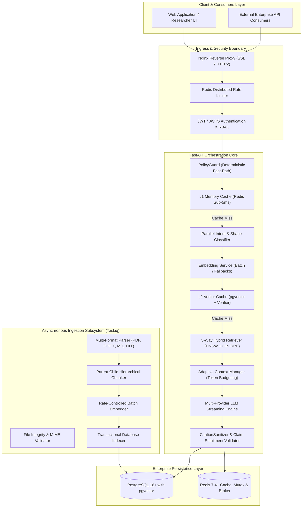

# 🏛️ المعمارية العامة للنظام (System Architecture Blueprint)
## وثيقة التصميم الهندسي للمنظومة الإنتاجية الموحدة لتقنيات RAG

---

### 1. نظرة عامة ورؤية التصميم (System Overview & Architectural Vision)

تم تصميم هذا المخطط الهندسي (**Production RAG Blueprint**) ليكون الأساس المعماري الصلب لأنظمة استرجاع المعلومات المدعومة بنماذج الذكاء الاصطناعي (Retrieval-Augmented Generation) ذات المتطلبات الإنتاجية الصارمة.

الهدف الأساسي هو الجمع بين **الدقة التوثيقية القطعية (Deterministic Grounding)**، **السرعة الفائقة مع كفاءة استهلاك الموارد (Low Latency & Cost Efficiency)**، و**المرونة المعمارية المجردة (Clean Architecture & Modularity)**، بحيث يمكن تكييف المنظومة مع مختلف المجالات المعرفية (كتب علمية، دوريات محكمة، وثائق قانونية، أبحاث طبية، أو أنظمة الدعم المؤسسي) دون المساس بالنواة الهندسية.

---

### 2. الأنماط والمبادئ المعمارية المعتمدة (Architectural Principles)

1. **معمارية الطبقات النظيفة (Clean Architecture / Hexagonal Architecture):**
   - **طبقة النطاق (Domain Layer):** تضم الكيانات والعقود (`Protocols`) والواجهات المجردة، وتخلو تماماً من أي اعتماد على أطر عمل خارجية أو قواعد بيانات.
   - **طبقة التطبيق (Application Layer):** تنسق تدفق الأعمال، مثل إدارة دورة الاستعلام، توجيه النوايا، وتنسيق التوليد.
   - **طبقة البنية التحتية (Infrastructure Layer):** مسؤولة عن التنفيذ الفعلي (PostgreSQL, pgvector, Redis, HTTP Clients, Taskiq).
   - **طبقة الواجهات (Interface / API Layer):** واجهات FastAPI ومسارات البث اللحظي (SSE) ونقاط استقبال الملفات.

2. **الامتناع الصريح وتفادي الهلوسة (Faithfulness & Explicit Abstention):**
   - النظام لا يختلق إجابات عند نقص الأدلة، بل يخضع الاسترجاع لتقييم كفاية صارم (`EvidenceEvaluator`)؛ فإذا كان السند ضعيفاً يمتنع النظام صراحة عن التوليد لتفادي التضليل.

3. **الكاش متعدد الأبعاد لحماية التكلفة والدقة (Hardened Multi-Dimensional Caching):**
   - الفصل التام بين الكاش اللحظي L1 في الذاكرة (Redis) والكاش الدلالي المتجهي L2 في قاعدة البيانات، مع قفل الطيران الفردي (`Single-Flight Mutex`) ومدقق التكافؤ التام (`Equivalence Verifier`) لتفادي مشكلة "التشابه اللفظي لا يعني التكافؤ الشرعي/العلمي".

4. **تسييج الأدلة وأمان البرومبت (Untrusted Evidence Enclosure):**
   - معاملة جميع النصوص المسترجعة كمدخلات غير موثوقة (`Untrusted Input`) وتسييجها داخل وسوم محصنة برمز عشوائي مشفر (`Cryptographic Nonce`) لمنع هجمات حقن البرومبت غير المباشرة (Indirect Prompt Injection).

---

### 3. المخطط الصندوقي للمنظومة (High-Level Component Diagram)

---

### 4. تقسيم الوحدات البرمجية والمسؤوليات (Module Responsibilities)

| الوحدة (Module) | المسار (Directory) | المسؤولية الهندسية الأساسية (Core Responsibility) |
| :--- | :--- | :--- |
| **النواة (Core)** | `src/core/` | الإعدادات المركزية عبر `Pydantic Settings`، خزنة المفاتيح المموهة `KeyVault`، السجلات المهيكلة `structlog`، ومعالجة الاستثناءات الموحدة. |
| **النطاق (Domain)** | `src/domain/` | تعريف الكيانات ونماذج البيانات النقية، والبروتوكولات (`Protocols`) لمزودي الخدمة، ومخططات المدخلات والمخرجات. |
| **الاستيعاب (Ingestion)** | `src/ingestion/` | قراءة ملفات PDF, DOCX, Markdown, TXT، استخراج البيانات الوصفية، والتجزئة الهرمية الأبوية والفرعية. |
| **الاسترجاع (Retrieval)** | `src/retrieval/` | محرك البحث الهجين 5-Way RRF $k=60$، تصنيف اللغات ووزن المتجهات، وتوجيه النوايا بالتوازي. |
| **إعادة الترتيب (Reranking)** | `src/reranking/` | إعادة الترتيب الحتمية السريعة (<2ms) مع دعم اختياري لنموذج Cross-Encoder في الحالات المعقدة. |
| **الكاش (Caching)** | `src/caching/` | الكاش المزدوج (L1 Redis + L2 pgvector)، قفل الطيران الفردي، وفحص التكافؤ التام. |
| **إدارة السياق (Context)** | `src/context/` | توزيع ميزانية التوكنز، ضغط المحادثات السابقة بدون بتر الكلمات، وتسييج الأدلة بنونس عشوائي. |
| **النماذج اللغوية (LLM)** | `src/llm/` | تجريد نماذج التوليد (Gemini 3.5, OpenAI, Anthropic, Ollama) مع إدارة التدفق الحي والاستئناف. |
| **التحقيق والاستشهاد (Citations)** | `src/citations/` | محاذاة الأقواس `[1]` مع المصادر، حذف أرقام الأشباح، واحتساب نسبة الاستلزام المعجمي. |
| **المراقبة (Observability)** | `src/observability/` | مقاييس Prometheus، تتبع OpenTelemetry، وسجلات التدقيق الأمني للعمليات. |
| **الواجهات البرمجية (API)** | `src/api/` | نقاط اتصال FastAPI، إدارة جلسات SSE، التحقق من الصلاحيات، ومحددات المعدل. |
| **العمال (Workers)** | `src/workers/` | مهام معالجة المستندات غير المتزامنة عبر Taskiq مع نقاط حفظ صلبة ضد الانهيار. |

---

### 5. دورة حياة الطلب عبر الحدود المعمارية (Data & Request Flow Boundaries)

1. **الوصول والتحقق السريع (Ingress & Gating):**
   - يدخل الطلب عبر Nginx، ثم يتحقق وسيط الأمان من هوية العميل أو حصة الزائر عبر Redis.
   - يمر الطلب فوراً بمحرك `PolicyGuard`؛ إذا كان السؤال تحية أو شكر، يُعاد الرد في أقل من `1ms` دون لمس قاعدة البيانات أو استهلاك أي توكن.
2. **فحص الذاكرة السريعة (L1 Fast Check):**
   - يتم احتساب بصمة الطلب (مع اللغة والشكل وشجرة المصادر) والبحث في Redis L1؛ في حال العثور عليه، يُبث الرد فوراً في أقل من `5ms`.
3. **التوازي الحكيم (Parallel Planning Branch):**
   - عند غياب الكاش، يستحوذ الطلب على قفل طيران فردي لمنع تكرار المعالجة مع طلبات مماثلة، ثم يُطلق طلب جلب سياق المحادثة من قاعدة البيانات بالتوازي مع تصنيف النية (`IntentRouter`) وتوليد المتجه الدلالي (`EmbeddingService`).
4. **الكاش الدلالي المتقدم (L2 Vector Cache):**
   - يُستعلم جدول `semantic_query_cache` في PostgreSQL بواسطة فهرس HNSW؛ فإذا وُجد تشابه دلالي $\ge 0.97$ يُعتمد الرد، وإذا كان بين $0.87$ و $0.97$ يتم التحقق عبر مدقق التكافؤ التام لضمان عدم وجود تناقض.
5. **البحث الهجين خماسي المسارات (5-Way Hybrid Search):**
   - استدعاء الدالة المخزنة `search_chunks_hybrid` لدمج البحث المتجهي مع 5 فهارس GIN معجمية عبر خوارزمية دمج الرتب المتبادلة $RRF(d) = \sum \frac{w}{60 + rank}$.
6. **حل السياق وإعادة الترتيب (Context Expansion & Reranking):**
   - تُجلب المقاطع الأبوية (`Parent Chunks`) دفعة واحدة بطلب SQL ذري، وتُدمج المقاطع التابعة لنفس الصفحة، وتُطبق قيود التنوع (`DiversityGuard`) لمنع احتكار فصل واحد للنتائج.
7. **التحقق من كفاية السند والتوليد (Sufficiency Check & SSE Streaming):**
   - يفحص `EvidenceEvaluator` قوة الأدلة؛ فإن كانت غير كافية يعتذر النظام فوراً، وإن كانت كافية يُبنى البرومبت الآمن ويُبث الرد لحظياً عبر SSE من نموذج Gemini 3.5.
8. **المعالجة اللاحقة والتثبيت الذري (Post-Generation & Grounding):**
   - بعد اكتمال البث، يُعيد `CitationSanitizer` ترتيب الأقواس لتطابق تماماً قائمة المصادر، وتُحسب درجة الاستلزام المعجمي، وتُخزن الإجابة المؤصلة في كاش L1 و L2 مع حفظ المحادثة.

