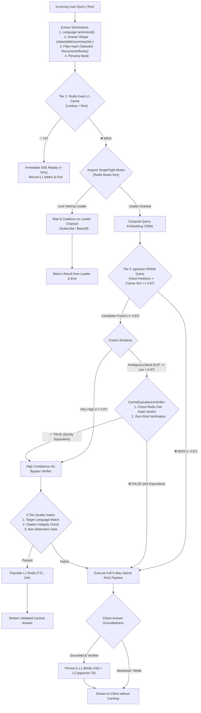

<div dir="rtl" style="text-align: right; direction: rtl;">

# ⚡️ الكاش الدلالي المتطور فائق الأمان (Hardened Semantic Cache Engine)
## الدليل المعماري والهندسي لمنظومة الكاش ثنائية الطبقات، قفل الطيران الفردي، ومدقق التكافؤ التام

---

### 1. فلسفة الكاش الدلالي ومعضلة المشاريع الإنتاجية (Design Philosophy)

في أنظمة الـ RAG العامة، يُفترض خطأً أن أي استعلامين تتجاوز المسافة الكوسينية بينهما عتبة `0.85` أو `0.90` هما استعلامان متطابقان ويمكن إرجاع نفس الإجابة لهما.
هذا الافتراض يمثل **خطراً فادحاً** في البيئات العلمية، الشرعية، القانونية، والطبية:
- *"ما هي **شروط** الصلاة؟"* $\ne$ *"ما هي **أركان** الصلاة؟"* (تشابه دلالي قد يتجاوز `0.93`، لكن الجوابين مختلفان تماماً).
- *"حكم زكاة الأسهم للمضارب"* $\ne$ *"حكم زكاة الأسهم للمستثمر طويل الأجل"*.
- *"ما مباحث المجلد الثالث في تدبر؟"* $\ne$ *"ما مباحث المجلد الرابع؟"*.

لذلك، تم ابتكار وتطبيق **معمارية الكاش رباعية الأبعاد (Multi-Dimensional Scoped Semantic Cache)** المدعومة بـ **مدقق التكافؤ التام (`CacheEquivalenceVerifier`)** و**قفل الطيران الفردي (`Single-Flight Mutex`)** لتحقيق سرعة استجابة فائقة مع ضمان نسبة صفرية من الخطأ (`Zero False Positives`).

---

### 2. معمارية الكاش ثنائية المستويات (Two-Tier Hybrid Storage)

</div>

<div dir="ltr" style="text-align: left; direction: ltr;">



</div>

<div dir="rtl" style="text-align: right; direction: rtl;">

---

### 3. الأبعاد الأربعة الصارمة للفرز والتخصيص (The 4 Hard Scoping Dimensions)

لا يمكن مطابقة الكاش بالاعتماد على متجه السؤال فحسب، بل يجب تطابق الأبعاد الأربعة الصارمة التالية:

| البعد (Dimension) | الحقل في قاعدة البيانات | الأثر الهندسي ودور الحماية |
| :--- | :--- | :--- |
| **1. لغة السؤال والإجابة** | `language` | يمنع تقديم إجابة سابقة باللغة العربية لسؤال مماثل كُتب بالإنجليزية أو الإسبانية (`Anti-Language Contamination`). |
| **2. الشكل الهيكلي للجواب** | `answer_shape` | إذا طلب المستخدم الجواب في "جدول مقارنة" (`markdown_table`)، يُحظر تقديم إجابة سردية سابقة (`narrative`) حتى لو تطابق موضوع السؤال. |
| **3. بصمة مصادر البحث** | `filter_hash` | بصمة `SHA-256` للمجلدات والكتب المحددة في واجهة المستعلم؛ يمنع تداخل نتائج كتاب مع كتاب آخر. |
| **4. الشخصية التوليدية** | `persona` | يمنع تقديم إجابة بأسلوب الباحث الأكاديمي المستفيض لمستخدم اختار نمط الإجابات السريعة والموجزة (`concise`). |

---

### 4. قفل الطيران الفردي الموزع (`Single-Flight Mutex`)

- **المشكلة:** عند حدوث بث مباشر أو مؤتمر أو إطلاق عام، يطرح آلاف المستخدمين نفس السؤال في نفس اللحظة (مثلاً: *"ما هي أهداف المؤتمر؟"*). بدون حماية، تنطلق آلاف استعلامات البحث والتضمين المتجهي واستدعاءات نماذج التوليد المكلفة بالتوازي.
- **الحل:**
  1. يُحسب مفتاح الطلب:
     <div dir="ltr" style="text-align: left; direction: ltr;">
     
     ```text
     rag:sf:{persona}:{lang}:{shape}:{filterHash}:{queryHash}
     ```
     </div>
  2. يُحاول الطلب الاستحواذ على قفل Redis:
     <div dir="ltr" style="text-align: left; direction: ltr;">
     
     ```text
     SET rag:sf:... "in_flight" NX EX 35
     ```
     </div>
  3. الطلب الأول (**القائد - Leader**) ينفذ المعالجة.
  4. بقية الطلبات (**المتابعون - Followers**) تنتظر إشعار النشر عبر Redis Pub/Sub أو استطلاع القيمة المخزنة، فتستلم الإجابة الجاهزة دون تشغيل مسار المعالجة مجدداً.

---

### 5. مدقق التكافؤ التام في النطاق الحرج (`CacheEquivalenceVerifier`)

عند وجود مرشح كاش في النطاق الحرج ($0.87 \le \text{Cosine Similarity} < 0.97$):
1. **فحص كاش القرارات المسبقة في Redis (Pair Hash):**
   - يُحسب مفتاح زوج السؤالين المشترك:
     <div dir="ltr" style="text-align: left; direction: ltr;">
     
     ```python
     pair_key = f"rag:verdict:{sha256(sorted([norm_q1, norm_q2]).join('::'))[:24]}"
     ```
     </div>
   - إذا تم فحص هذا الزوج سابقاً، يُؤخذ القرار المحفوظ في Redis فوراً (< 1ms).
2. **التحقق السريع عبر نموذج خفيف (Gemini 3.5 Flash Lite):**
   - في حال عدم وجود كاش للقرار، يُرسل استعلام بصيغة JSON مغلقة إلى النموذج الخفيف:
     <div dir="ltr" style="text-align: left; direction: ltr;">
     
     ```json
     {
       "stored_query": "ما هي شروط الصلاة؟",
       "incoming_query": "ما هي أركان الصلاة؟",
       "rules": "Different Islamic rulings or different topics must evaluate to equivalent: false"
     }
     ```
     </div>
   - النموذج يرجع حصراً: `{"equivalent": false, "reason": "Difference between conditions and pillars"}`.
   - يُخزن هذا الحكم في Redis لمدة 7 أيام.
   - في حال حدوث أي خطأ في الشبكة أو نفاد مهلة الفحص (Timeout > 2000ms)، يفشل المدقق بشكل آمن مغلق (`Fail-Closed: equivalent = false`) ويُجبر النظام على تشغيل مسار الـ RAG الكامل لحماية صحة المعلومة.

---

### 6. جدول قاعدة البيانات للدلالة المتجهية (`semantic_query_cache`)

<div dir="ltr" style="text-align: left; direction: ltr;">

```sql
CREATE TABLE IF NOT EXISTS semantic_query_cache (
    id UUID PRIMARY KEY DEFAULT gen_random_uuid(),
    query_text TEXT NOT NULL,
    normalized_query TEXT NOT NULL,
    query_embedding vector(768) NOT NULL,
    response_text TEXT NOT NULL,
    sources JSONB NOT NULL DEFAULT '[]'::jsonb,
    suggestions JSONB NOT NULL DEFAULT '[]'::jsonb,
    persona VARCHAR(50) NOT NULL DEFAULT 'standard',
    language VARCHAR(10) NOT NULL DEFAULT 'ar',
    answer_shape VARCHAR(50) NOT NULL DEFAULT 'standard',
    filter_hash VARCHAR(64) NOT NULL DEFAULT 'ALL',
    embedding_model VARCHAR(64) NOT NULL DEFAULT 'gemini-embedding-2',
    corpus_version VARCHAR(32) NOT NULL DEFAULT 'v1',
    schema_version VARCHAR(32) NOT NULL DEFAULT 'v1',
    format_directive VARCHAR(32) NOT NULL DEFAULT 'none',
    hit_count INTEGER NOT NULL DEFAULT 1,
    grounding_audit JSONB DEFAULT '{}'::jsonb,
    created_at TIMESTAMPTZ NOT NULL DEFAULT NOW(),
    last_hit_at TIMESTAMPTZ NOT NULL DEFAULT NOW(),
    expires_at TIMESTAMPTZ NOT NULL DEFAULT (NOW() + interval '7 days')
);

-- Unique Deduplication Across Hard Dimensions
CREATE UNIQUE INDEX IF NOT EXISTS uq_semantic_cache_entry 
ON semantic_query_cache (
    normalized_query, persona, language, filter_hash, 
    format_directive, embedding_model, corpus_version, schema_version
);

-- High-Recall HNSW Index for Candidates Lookup
CREATE INDEX IF NOT EXISTS idx_semantic_cache_vector_hnsw 
ON semantic_query_cache 
USING hnsw (query_embedding vector_cosine_ops) 
WITH (m = 16, ef_construction = 64);
```

</div>

<div dir="rtl" style="text-align: right; direction: rtl;">

---

### 7. إبطال الكاش وتدوير النسخ (Invalidation & Corpus Versioning)

- **بصمة محتوى المستودع المعرفي (`corpus_version`):**
  عند إضافة مستندات جديدة أو تعديل كتاب معتمد، يُحدث رقم الإصدار في جدول الإعدادات:
  <div dir="ltr" style="text-align: left; direction: ltr;">
  
  ```sql
  UPDATE system_settings SET value = jsonb_build_object('version', 'v2') WHERE key = 'corpus_version';
  ```
  </div>
- هذا يؤدي تلقائياً وبشكل فوري وذري إلى إهمال مدخلات الكاش السابقة المعلمة بـ `v1` دون الحاجة لعمليات حذف مكلفة على قاعدة البيانات، مع بقاء مدخلات `v1` كأرشيف تاريخي أو إزالتها في مهام التنظيف الخلفية الدورية.

</div>
