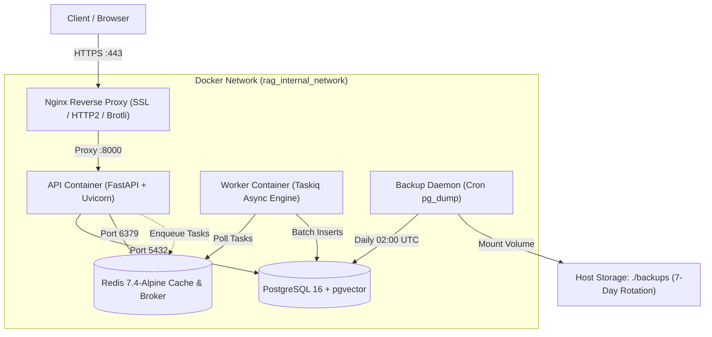

<div dir="rtl" style="text-align: right; direction: rtl;">

# 🚀 النشر والتشغيل الإنتاجي والحاويات (Production Deployment & Docker Architecture)
## الدليل التشغيلي لحاويات Docker، إعدادات Nginx، النسخ الاحتياطي، وإدارة الموارد

---

### 1. نظرة عامة على المعمارية التحتية (Infrastructure Overview)

تتألف المنظومة الإنتاجية من **حاويات Docker متخصصة** تعمل داخل شبكة داخلية معزولة (`rag_internal_network`)، وتتصل بالعالم الخارجي عبر بوابة آمنة مشفرة:

</div>

<div dir="ltr" style="text-align: left; direction: ltr;">



</div>

<div dir="rtl" style="text-align: right; direction: rtl;">

---

### 2. مصفوفة الحاويات والخدمات (Container Services Matrix)

| الحاوية (Container Name) | الصورة الأساسية (Base Image) | المنافذ الداخلية | حدود الموارد الموصى بها (RAM / CPU) | المسؤولية والوظيفة |
| :--- | :--- | :---: | :---: | :--- |
| **`rag_api`** | `python:3.12-slim` (Multi-stage) | `8000` | `2 GB / 2.0 CPU` | معالجة واجهات REST، البث اللحظي SSE، الكاش، والاستعلامات. |
| **`rag_worker`** | `python:3.12-slim` (Multi-stage) | - | `4 GB / 4.0 CPU` | مهام معالجة الملفات الكبيرة، التقطيع، واستدعاءات التضمين. |
| **`rag_postgres`** | `pgvector/pgvector:pg16` | `5432` | `4 GB / 2.0 CPU` | تخزين الوثائق، المتجهات، فهارس HNSW، والبحث المعجمي. |
| **`rag_redis`** | `redis:7.4-alpine` | `6379` | `1 GB / 1.0 CPU` | كاش L1 السطحي، قفل الطيران الفردي، وسيط مهام Taskiq. |
| **`rag_nginx`** | `nginx:alpine` | `80, 443` | `512 MB / 1.0 CPU` | إنهاء تشفير SSL، توجيه الحركة، وتحسين بث SSE بدون تخزين مؤقت. |
| **`rag_backup`** | `postgres:16-alpine` | - | `256 MB / 0.5 CPU` | تنفيذ النسخ الاحتياطي اليومي وتدوير الملفات لمدة 7 أيام. |

---

### 3. إعدادات خادم Nginx المتخصصة في بث SSE (Nginx SSE Configuration)

أحد أبرز أخطاء نشر أنظمة الـ RAG عبر Nginx هو تفعيل التخزين المؤقت للردود (Response Buffering)، مما يمنع وصول التوكنز للمستخدم فور توليدها ويجعلها تصل ككتلة واحدة بعد ثوانٍ طويلة.
تم تخصيص إعدادات Nginx لدعم البث فائق السرعة:

<div dir="ltr" style="text-align: left; direction: ltr;">

```nginx
# Production Nginx Configuration for FastAPI SSE Streaming
server {
    listen 443 ssl http2;
    server_name rag.example.com;

    ssl_certificate /etc/nginx/certs/fullchain.pem;
    ssl_certificate_key /etc/nginx/certs/privkey.pem;
    ssl_protocols TLSv1.2 TLSv1.3;
    ssl_ciphers HIGH:!aNULL:!MD5;

    # Maximum file upload size for documents
    client_max_body_size 50M;

    # Core API and SSE Route
    location /api/ {
        proxy_pass http://rag_api:8000;
        proxy_http_version 1.1;

        # CRITICAL: Disable Buffering for Real-Time SSE Streaming
        proxy_buffering off;
        proxy_cache off;
        proxy_set_header Connection '';
        chunked_transfer_encoding on;

        # Keep-Alive and Extended Timeouts for Long Generation
        proxy_read_timeout 600s;
        proxy_send_timeout 600s;

        # Standard Forwarding Headers
        proxy_set_header Host $host;
        proxy_set_header X-Real-IP $remote_addr;
        proxy_set_header X-Forwarded-For $proxy_add_x_forwarded_for;
        proxy_set_header X-Forwarded-Proto $scheme;
    }

    # Healthcheck Route (Internal or Monitoring)
    location /api/health/ {
        proxy_pass http://rag_api:8000;
        access_log off;
    }
}
```

</div>

---

### 4. ملف بناء الحاوية متعدد المراحل (`Multi-Stage Dockerfile`)

<div dir="ltr" style="text-align: left; direction: ltr;">

```dockerfile
# Stage 1: Build & Dependencies Compiler
FROM python:3.12-slim AS builder

WORKDIR /build

RUN apt-get update && apt-get install -y --no-install-recommends \
    build-essential \
    curl \
    libpq-dev \
    && rm -rf /var/lib/apt/lists/*

COPY pyproject.toml .
RUN pip install --no-cache-dir --upgrade pip && \
    pip install --no-cache-dir --prefix=/install .

# Stage 2: Minimal Production Runtime
FROM python:3.12-slim AS runtime

WORKDIR /app

RUN apt-get update && apt-get install -y --no-install-recommends \
    libpq5 \
    curl \
    && rm -rf /var/lib/apt/lists/*

# Copy installed wheels from builder
COPY --from=builder /install /usr/local
COPY . .

# Create non-root user for enterprise security
RUN useradd -m -u 1001 appuser && \
    chown -R appuser:appuser /app
USER appuser

EXPOSE 8000

HEALTHCHECK --interval=30s --timeout=5s --start-period=10s --retries=3 \
  CMD curl -f http://localhost:8000/api/health/liveness || exit 1

CMD ["uvicorn", "src.api.app:app", "--host", "0.0.0.0", "--port", "8000", "--workers", "4"]
```

</div>

---

### 5. نظام النسخ الاحتياطي اليومي والتدوير الآلي (Backup & Rotation Script)

يعمل سكريبت `backup.sh` يومياً في تمام الساعة `02:00` عبر حاوية `rag_backup`:
1. تنفيذ `pg_dump` بصيغة مضغوطة (`custom format .dump.gz`).
2. إنشاء تجزئة `SHA-256` للتحقق من سلامة النسخة الاحتياطية.
3. تدوير الملفات وحذف النسخ التي مضى عليها أكثر من 7 أيام لتوفير مساحة التخزين.

<div dir="ltr" style="text-align: left; direction: ltr;">

```bash
#!/bin/sh
set -e

BACKUP_DIR="/backups"
TIMESTAMP=$(date +"%Y%m%d_%H%M%S")
BACKUP_FILE="${BACKUP_DIR}/rag_db_${TIMESTAMP}.dump"

echo "[Backup] Starting PostgreSQL backup: ${BACKUP_FILE}"
pg_dump -h rag_postgres -U "${POSTGRES_USER}" -d "${POSTGRES_DB}" -Fc -f "${BACKUP_FILE}"

# Generate SHA256 verification hash
sha256sum "${BACKUP_FILE}" > "${BACKUP_FILE}.sha256"
echo "[Backup] Backup completed with checksum verification."

# Retention Policy: Delete backups older than 7 days
echo "[Backup] Pruning backups older than 7 days..."
find "${BACKUP_DIR}" -name "rag_db_*.dump" -mtime +7 -delete
find "${BACKUP_DIR}" -name "rag_db_*.sha256" -mtime +7 -delete
echo "[Backup] Maintenance cycle complete."
```

</div>
