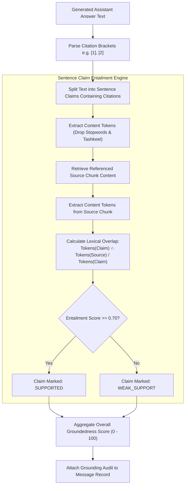

<div dir="rtl" style="text-align: right; direction: rtl;">

# 📊 إطار التقييم وقياس الجودة (Evaluation & Quality Assessment Framework)
## الدليل المعماري لقياس دقة الاسترجاع، موثوقية التوليد، ونسبة الاستلزام المعجمي

---

### 1. فلسفة التقييم في بيئات الإنتاج (Evaluation Philosophy)

في أنظمة الـ RAG، **لا يمكن افتراض صحة النظام لمجرد أنه يرجع نصاً منسقاً وجميلاً**.
يجب أن يخضع النظام لتقييم كمي ونوعي مزدوج:
1. **تقييم جودة الاسترجاع (Retrieval Evaluation):** هل استرجع المحرك المقاطع والصفحات الحقيقية التي تحوي الإجابة الصحيحة؟
2. **تقييم جودة التوليد والتأصيل (Generation & Grounding Evaluation):** هل اعتمد النموذج حصراً على المقاطع المسترجعة؟ وهل أرقام الاستشهادات `[1]` تشير بدقة إلى الجمل التي تدعم الادعاء؟

---

### 2. مصفوفة مقاييس الجودة الشاملة (Comprehensive Evaluation Metrics)

| مرحلة التقييم | المقياس الهندسي (Metric) | التعريف الرياضي / الوظيفي | الهدف الإنتاجي الأدنى (Production SLA) |
| :--- | :--- | :--- | :---: |
| **الاسترجاع (Retrieval)** | **Recall@K** ($K=5, 10$) | نسبة الأسئلة التي احتوت أول $K$ نتائج مسترجعة على المقطع المرجعي الذهبي. | $\ge 92.0\%$ |
| **الاسترجاع (Retrieval)** | **Precision@K** ($K=5$) | نسبة المقاطع ذات الصلة الحقيقية من بين المقاطع المسترجعة في أول $K$. | $\ge 75.0\%$ |
| **الاسترجاع (Retrieval)** | **MRR (Mean Reciprocal Rank)** | متوسط مقلوب رتبة أول مقطع صحيح: $\frac{1}{|Q|} \sum \frac{1}{\text{rank}_i}$. | $\ge 0.85$ |
| **التأصيل (Grounding)** | **Claim Entailment Score** | نسبة الكلمات المعجمية الهامة في كل جملة ادعاء الموجودة فعلياً في المصدر المحال إليه. | $\ge 88.0\%$ |
| **الاستشهادات (Citations)** | **Phantom Citation Rate** | نسبة أرقام الاستشهادات الوهمية التي لا وجود لمصدر مقابل لها في السياق. | **$0.0\%$ (Strict Zero)** |
| **الأمانة (Faithfulness)** | **Hallucination Rate** | نسبة الجمل التي تورد حقائق تاريخية أو أحكاماً لم ترد في الوثائق المرفوعة. | $\le 2.0\%$ |
| **الامتناع (Abstention)** | **Honest Refusal Rate** | نسبة الامتناع الصريح في الأسئلة التي لا يتوفر لها سند في قاعدة المعرفة. | $\ge 98.0\%$ |
| **الأداء اللحظي (Performance)** | **Time-to-First-Token (TTFT)** | الزمن المنقضي بين ضغط الإرسال واستلام أول حرف في بث SSE. | $< 1,200\text{ ms}$ (L1 Cache $< 5\text{ms}$) |

---

### 3. تدقيق الاستلزام المعجمي على مستوى الادعاء (`Claim-Level Lexical Entailment`)

يعمل محرك `CitationValidator` على فحص الإجابة بعد اكتمال التوليد عبر الخطوات التالية:

</div>

<div dir="ltr" style="text-align: left; direction: ltr;">



</div>

<div dir="rtl" style="text-align: right; direction: rtl;">

---

### 4. معالجة وتصحيح الاستشهادات حتمياً (`CitationSanitizer`)

يقوم `CitationSanitizer` بضمان التناسق بنسبة 100% بين نص الجواب وبطاقات المصادر المعروضة للمستخدم:
1. **تحويل الأرقام المشرقية:** تحويل الأقواس مثل `[٣]` أو `[المصدر #٤]` إلى صيغة رقمية موحدة `[3]` و `[4]`.
2. **إزالة الاستشهادات الشبحية (Phantom Stripping):** إذا استشهد النموذج برقم `[8]` بينما عدد المصادر الممررة له هو 5 مصادر فقط، يتم تجريد الرقم الشبح فوراً.
3. **إعادة الترقيم التسلسلي والمحاذاة التامة (Sequential Alignment):**
   - إذا استشهد النموذج في الإجابة بالمصدرين `[2]` و `[4]` فقط ولم يستشهد بالمصادر `[1, 3, 5]`:
   - يقوم المعالج بتحويل `[2]` إلى `[1]`، وتحويل `[4]` إلى `[2]` داخل النص.
   - يتم تقليم قائمة المصادر (`Pruned Sources`) لتقتصر حصراً على المرجعين المستشهد بهما مع إعطائهما الترتيب الجديد `source_index: 1` و `source_index: 2`، مع الاحتفاظ بـ `original_source_index`.
   - هذا يضمن أن المستمع عندما ينقر على البطاقة المرجعية رقم `1` يفتح له المرجع الذي يطابق الاقتباس الأول بدقة قطعية.

---

### 5. حزمة بيانات المعايرة والتقييم الآلي (`Benchmark Dataset Structure`)

تتضمن المنظومة إمكانية تشغيل حزم تقييم قياسية (`benchmark_dataset.json`) لقياس أي تحديثات معمارية ومنع أي ارتداد في الأداء (Regression Testing):

<div dir="ltr" style="text-align: left; direction: ltr;">

```json
[
  {
    "query_id": "eval_001",
    "query_text": "ما هي المقاصد التربوية لقصة استخلاف آدم في سورة البقرة؟",
    "language": "ar",
    "expected_document_ids": ["doc_tadabbur_issue_21"],
    "expected_page_numbers": [42, 43],
    "ground_truth_claims": [
      "إعداد الخليفة لعمارة الأرض",
      "الابتلاء بالشهوة والتوبة كمنهج دائم"
    ],
    "difficulty": "medium",
    "answer_shape": "procedural_steps"
  }
]
```

</div>

<div dir="rtl" style="text-align: right; direction: rtl;">

---

### 6. بروتوكول مشغل التقييم الآلي (Evaluation Runner Interface)

<div dir="ltr" style="text-align: left; direction: ltr;">

```python
from typing import Dict, Any, List
from dataclasses import dataclass

@dataclass
class EvaluationReport:
    total_queries: int
    recall_at_5: float
    recall_at_10: float
    mrr: float
    avg_groundedness_score: float
    phantom_citation_rate: float
    average_ttft_ms: float
    failed_queries: List[Dict[str, Any]]

class RAGEvaluator:
    async def run_benchmark(self, dataset_path: str) -> EvaluationReport:
        """Executes full benchmark evaluation against active database & LLM."""
        ...
```

</div>
