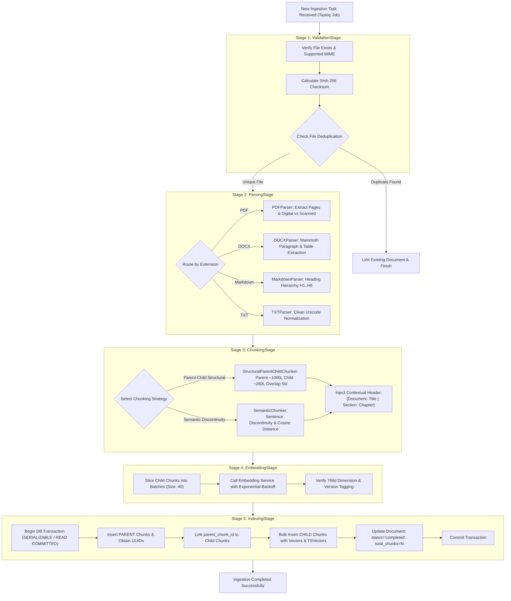

<div dir="rtl" style="text-align: right; direction: rtl;">

# 📥 خط الاستيعاب والمعالجة المستندية (Document Ingestion Pipeline)
## الدليل الهندسي لمحرك المعالجة الخلفية، المحللات، التجزئة الهرمية، والفهرسة الذرية

---

### 1. نظرة عامة على معمارية الاستيعاب (Ingestion Architecture)

صُمم خط الاستيعاب ليعمل كنظام معالجة خلفي مستقل وغير متزامن (Asynchronous Worker Pipeline) باستخدام **Taskiq** و **Redis**.
يتميز الخط بالخصائص الهندسية التالية:
1. **المعالجة المرحلية الصارمة (Staged Pipeline):** تقسيم العملية إلى 5 مراحل واضحة (التحقق $\to$ التحليل $\to$ التجزئة $\to$ التضمين المتجهي $\to$ الفهرسة).
2. **نقاط الحفظ والاستئناف (Checkpoints & Resumability):** تسجيل حالة كل مرحلة في قاعدة البيانات (`checkpoint_stage`) لتفادي إعادة معالجة الملفات الكبيرة في حال انقطاع الخادم.
3. **الفهرسة الذرية (Atomic Transactional Indexing):** إدخال جميع المقاطع (Parent و Child) وتحديث حالة المستند ضمن معاملة قاعدة بيانات واحدة (`BEGIN ... COMMIT`)، مما يمنع تشوه البيانات عند حدوث أي خطأ مفاجئ.

---

### 2. مخطط تدفق مراحل الاستيعاب الخمس (5-Stage Ingestion Flow)

</div>

<div dir="ltr" style="text-align: left; direction: ltr;">



</div>

<div dir="rtl" style="text-align: right; direction: rtl;">

---

### 3. تفصيل المراحل الهندسية (Staged Pipeline Breakdown)

#### المرحلة 1: التحقق والتدقيق (`ValidationStage`)
- **فحص سلامة الملف:** التحقق من وجود الملف، وقراءة أول بضعة بايتات للتأكد من بصمة الملف السحرية (Magic Bytes) لتفادي هجمات الملفات المزيفة.
- **حساب بصمة SHA-256:** لمنع تكرار معالجة نفس الملف (`file_hash`)، وفي حال تكراره يتم ربط السجل الجديد دون استنزاف موارد المعالجة.
- **تحديث نقطة الحفظ:** `UPDATE documents SET checkpoint_stage = 'VALIDATED'`.

#### المرحلة 2: التحليل واستخراج البنية (`ParsingStage`)
يعتمد النظام على محللات برمجية متخصصة ومجردة:
1. **محلل الـ PDF (`PDFParser`):**
   - استخراج النصوص حسب حدود الصفحات الحقيقية، مع تمييز ملفات PDF الرقمية عن الممسوحة ضوئياً (`scanned_no_ocr`).
2. **محلل الـ Word (`DOCXParser`):**
   - استخراج الفقرات والجداول النصية مع المحافظة على التسلسل الهيكلي.
3. **محلل الـ Markdown (`MarkdownParser`):**
   - رصد العناوين من `H1` إلى `H6` وبناء الشجرة المعرفية ومسارات المباحث (`Breadcrumbs`).
4. **محلل النصوص الخام (`TXTParser`):**
   - توحيد ترميز UTF-8 وإزالة البايتات الصفرية (`0x00`) التي تسبب انهيار PostgreSQL.

#### المرحلة 3: التجزئة الهرمية الأبوية-الفرعية (`ChunkingStage`)
- **المقاطع الأبوية (`PARENT Chunks`):**
  - الحجم المستهدف: `800 - 1200` توكن.
  - تمثل الفصول أو المباحث الكاملة وتُستخدم كمصدر سياقي نهائي يمرر للنموذج اللغوي.
- **المقاطع الفرعية (`CHILD Chunks`):**
  - الحجم المستهدف: `250 - 300` توكن مع تداخل `50` توكن.
  - هي المقاطع التي يتم توليد المتجهات الدلالية لها وإدخالها في فهارس HNSW.
- **الترويسة المعرفية المدمجة (Contextual Header Injection):**
  - يُحقن في مطلع كل مقطع فرعي سطر تعريفي:
    <div dir="ltr" style="text-align: left; direction: ltr;">
    
    ```text
    [Document: {docTitle} | Section: {chapterTitle} | Page: {pageNumber}]
    ```
    </div>
  - هذا يضمن بقاء المقاطع الفرعية محتفظة بهويتها وسياقها حتى عند عزلها في فضاء المتجهات.

#### المرحلة 4: التضمين المتجهي الجماعي والتحكم بالمعدل (`EmbeddingStage`)
- تجزئة المقاطع الفرعية إلى دفعات محكومة (Batch size = 40).
- إرسال الطلبات إلى `EmbeddingService` مع آلية التراجع الأسي العشوائي (Jittered Exponential Backoff) عند مواجهة حدود الاستهلاك (HTTP 429).
- التحقق من مطابقة الأبعاد (`768d`) ووسم كل متجه بنسخة النموذج المستخدم.

#### المرحلة 5: الفهرسة الذرية وحفظ البيانات (`IndexingStage`)
- تجميع عمليات الإدخال داخل معاملة SQL واحدة:
  1. إدخال المقاطع الأبوية والحصول على معرفاتها `UUID`.
  2. ربط المقاطع الفرعية بمعرفات آبائها `parent_chunk_id`.
  3. تنفيذ إدخال جماعي (`COPY` أو `UNNEST`) للمقاطع الفرعية مع متجهاتها ونصوصها وفهارس البحث النصي `tsvector`.
  4. تحديث حالة الوثيقة إلى `completed` وتسجيل عدد المقاطع الإجمالي.
  5. تأكيد المعاملة (`COMMIT`)، أو التراجع التام (`ROLLBACK`) في حال حدوث أي استثناء، مع تدوين رسالة الخطأ في حقل `error_message`.

---

### 4. واجهة المحلل المجردة (Abstract Parser Protocol)

<div dir="ltr" style="text-align: left; direction: ltr;">

```python
from typing import Protocol, List, Dict, Any
from dataclasses import dataclass

@dataclass
class ParsedPage:
    page_number: int
    text: str
    metadata: Dict[str, Any]

@dataclass
class ParsedDocument:
    raw_text: str
    pages: List[ParsedPage]
    metadata: Dict[str, Any]
    extraction_method: str
    language: str

class DocumentParser(Protocol):
    async def extract(self, file_path: str) -> ParsedDocument:
        """Parses a local file into a structured ParsedDocument."""
        ...
```

</div>

<div dir="rtl" style="text-align: right; direction: rtl;">

---

### 5. عزل الأخطاء ونظام المهام الميتة (Dead-Letter & Failure Isolation)

- إذا فشلت مهمة الاستيعاب بعد 3 محاولات (Retries):
  1. تُسجل المهمة في جدول `ingestion_jobs` بحالة `failed` مع تسجيل الـ Stack Trace كاملاً.
  2. يُحدث سجل المستند في جدول `documents` بحالة `failed`.
  3. تُحذف أي متجهات أو مقاطع غير مكتملة مرتبطة بالوثيقة تجنباً لتلوث قاعدة البيانات.
  4. تُرسل إشارة تنبيه فورية عبر نظام المراقبة (Prometheus Metric / Structured Log).

</div>
