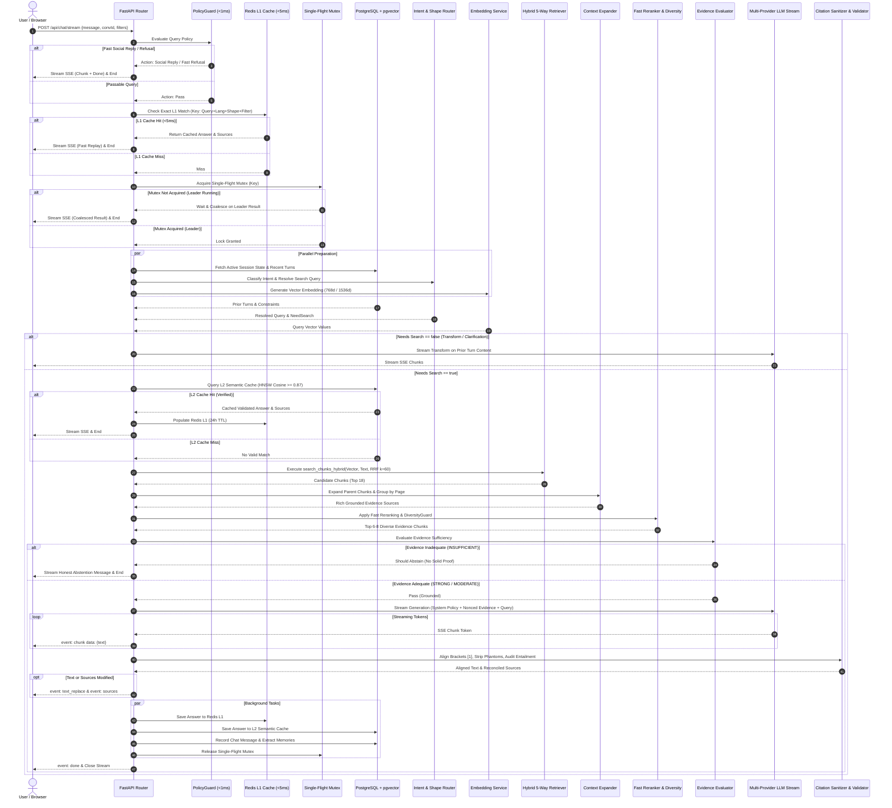

<div dir="rtl" style="text-align: right; direction: rtl;">

# 🔄 مسار معالجة الاستعلام الكامل (End-to-End Query Lifecycle Pipeline)
## الدليل التشغيلي لمسار التدفق اللحظي للـ RAG من الاستلام حتى إنهاء البث

---

### 1. نظرة عامة على دورة حياة الطلب (Pipeline Overview)

يمثل مسار معالجة الاستعلام في هذه المنظومة تسلسلاً هندسياً دقيقاً ومحكماً، صُمم خصيصاً للقضاء على نقاط الاختناق الشائعة في أنظمة الـ RAG، مثل:
1. **تأخير أول توكن (High Time-to-First-Token - TTFT)** الناجم عن استدعاءات LLM المتتالية قبل التوليد.
2. **استنزاف موارد الخادم والتكلفة المالية** بسبب معالجة التحيات والأسئلة الخارجة عن النطاق.
3. **التدافع المتزامن (Cache Stampede / Thundering Herd)** عند ورود نفس السؤال من مئات المستخدمين في الوقت ذاته.
4. **تلوث اللغات والهلوسة المرجعية** عند اختلاف لغة السؤال أو ضعف السند المعرفي في الوثائق.

---

### 2. مخطط تدفق الحالة اللحظية (Detailed State Flow Diagram)

</div>

<div dir="ltr" style="text-align: left; direction: ltr;">



</div>

<div dir="rtl" style="text-align: right; direction: rtl;">

---

### 3. تفصيل مراحل المسار الـ 12 (The 12 Pipeline Stages)

#### المرحلة 1: التدقيق الحتمي الأولي (`PolicyGuard`)
- **الهدف:** فحص السؤال في زمن أقل من `1ms` باستخدام تعبيرات نمطية وقواميس لغوية حتمية معالجة في الذاكرة.
- **التصنيفات:**
  1. `social_reply`: تحيات الإسلام، الترحيب العام، الشكر والثناء، أو السؤال عن الحال. يُعاد الجواب فوراً باللغة المناسبة مع مقترحات أسئلة انطلاق.
  2. `fast_refusal`: أسئلة حية خارجة عن الوثائق (أسعار الذهب، الطقس، الأسهم، الفتاوى الشخصية الحساسة، أو أكواد برمجية عشوائية). يُعتذر للسائل فوراً.
  3. `pass`: سؤال معرفي صالح للبحث؛ يُمرر للمرحلة التالية.

#### المرحلة 2: فحص الكاش السطحي الفوري (`L1 Exact Memory Cache`)
- **الهدف:** البحث في Redis عن تطابق قطعي فوري للأجوبة السابقة.
- **تركيب المفتاح:**
  <div dir="ltr" style="text-align: left; direction: ltr;">
  
  ```text
  rag:l1:{persona}:{lang}:{shape}:{filter_hash}:{sha256(normalized_query)[:24]}
  ```
  </div>
- في حال العثور عليه، يُبث الرد كاملاً في أقل من `5ms` مع انعدام استهلاك أي حصة لنموذج الذكاء الاصطناعي.

#### المرحلة 3: قفل الطيران الفردي الموزع (`Single-Flight Mutex`)
- **الهدف:** منع مشكلة الانهيار المتزامن (Thundering Herd Problem).
- **الآلية:** إذا أرسل 50 مستخدماً نفس السؤال في نفس الثانية، يستحوذ الطلب الأول فقط على قفل Redis (`SET resource NX EX 30`) ليكون "القائد"، بينما تنتظر باقي الطلبات وتستمع لقناة النشر (Pub/Sub) أو استطلاع النتيجة لحظة حفظها، مما يوفر 98% من تكلفة المعالجة.

#### المرحلة 4: المعالجة المتوازية الذكية (Parallel Branching)
- بدلاً من تنفيذ الخطوات بالتسلسل، يُطلق النظام 3 مهام غير متزامنة في نفس اللحظة:
  1. جلب الدورات الحوارية السابقة والذاكرة النشطة للمحادثة من PostgreSQL.
  2. تحليل النية والشكل المطلوب عبر `IntentRouter` لتحديد هل السؤال جديد أم استطرادي أم طلب إعادة صياغة.
  3. توليد المتجه الدلالي للسؤال (`768` بعداً) عبر `EmbeddingService`.

#### المرحلة 5: الكاش الدلالي المتجهي المتطور (`L2 Semantic Cache`)
- **الهدف:** اكتشاف الأسئلة المتطابقة في المعنى والمختلفة في الصياغة اللفظية.
- **البحث:** استعلام فهرس `HNSW` على جدول `semantic_query_cache` مع حصر الفرز بالأبعاد الأربعة (الشخصية، اللغة، شكل الجواب، وبصمة المرشحات).
- **منع الإجابات الزائفة:**
  - إذا كان التشابه الدلالي $\ge 0.97$: يُعتبر تطابقاً تاماً.
  - إذا كان التشابه الدلالي بين $0.87$ و $0.97$: يُستدعى `CacheEquivalenceVerifier` (مع كاش مسبق للثنائيات في Redis) للتحقق مما إذا كان الجواب القديم يكافئ تماماً مقصود السؤال الجديد دون أي تضارب.

#### المرحلة 6: البحث الهجين خماسي المسارات (`5-Way Hybrid RRF Retrieval`)
- استدعاء الدالة المدمجة `search_chunks_hybrid` التي تجمع:
  1. المسار المتجهي: بحث `pgvector` عبر المسافة الكوسينية (`vector_cosine_ops`).
  2. 5 مسارات معجمية: فهارس `GIN` عبر قواميس `arabic`, `simple`, `english`, `spanish`, `portuguese`.
  3. الدمج عبر معادلة:
     $$RRF(d) = \sum_{m \in M} \frac{w_m}{k + \text{rank}_m(d)}, \quad k = 60$$

#### المرحلة 7: توسيع السياق وحل المقاطع الأبوية (`ContextExpander`)
- المقاطع المسترجعة هي مقاطع فرعية (`CHILD Chunks ~280t`).
- يقوم المحرك بجلب المقاطع الأبوية الشاملة (`PARENT Chunks ~1000t`) دفعة واحدة بطلب SQL ذري (`id = ANY($1::uuid[])`).
- يتم تجميع المقاطع المتعددة التابعة لنفس الصفحة أو الفصل في بطاقة مرجعية واحدة لتفادي تكرار البطاقات في واجهة المستخدم.

#### المرحلة 8: إعادة الترتيب الحتمي وتنوع المصادر (`Reranker & DiversityGuard`)
- تطبيق خوارزمية الترتيب الحتمية السريعة في الميكروثانية بناءً على تطابق العبارة ونسبة تغطية المصطلحات وتشابه المتجه.
- تطبيق `DiversityGuard`: حظر استئثار فصل أو كتاب واحد بأكثر من مقطعين (`maxPerBook=2`) لضمان تنوع الأدلة وشموليتها.

#### المرحلة 9: تقييم كفاية الأدلة والامتناع الصريح (`EvidenceEvaluator`)
- فحص درجات التشابه والرتبة؛ فإذا كان السند ضعيفاً جداً (`similarity < 0.35` وانعدام التطابق المعجمي)، يمتنع المحرك فوراً عن استدعاء نموذج التوليد ويرسل رسالة اعتذار رصينة تثبت أمانة النظام وعدم تلفيقه للبيانات.

#### المرحلة 10: بناء السياق الآمن وبث التوليد اللحظي (`Adaptive Context & SSE`)
- يوزع `AdaptiveContextManager` ميزانية التوكنز بدقة (تعليمات النظام $\to$ الذاكرة $\to$ ملخص الدورات $\to$ الأدلة المسترجعة $\to$ السؤال).
- تسييج الأدلة برمز عشوائي (`Cryptographic Nonce`) يمنع تجاوز تعليمات النظام.
- بدء البث المباشر للأحرف والكلمات عبر بروتوكول Server-Sent Events (SSE) باستخدام نموذج `Gemini 3.5`، مع مراقبة مبكرة لأول 100 حرف لمنع انحراف اللغة الهدف (`Language Drift Guard`).

#### المرحلة 11: تدقيق الاستشهادات وتحقيق الاستلزام (`Citation Alignment & Entailment`)
- فور انتهاء البث، يتدخل `CitationSanitizer`:
  - تحويل الأرقام المشرقية `[١]` إلى أرقام قياسية `[1]`.
  - حذف أرقام المراجع الشبحية (مثل ورود `[9]` بينما المراجع المتاحة 4 فقط).
  - إعادة فهرسة الأقواس تسلسلياً (مثلاً: إذا استشهد الجواب بـ `[3, 4]` فقط، تصبح في النص `[1, 2]` وتُطابق قائمة المصادر).
  - حساب نسبة الاستلزام المعجمي (`claimEntailmentScore`) بين كل ادعاء والمقطع المحال إليه.

#### المرحلة 12: الحفظ المتزامن والمقترحات والذاكرة (Post-Processing & Telemetry)
- حفظ الجواب في كاش L1 (Redis) لمدة 24 ساعة.
- حفظ الجواب في كاش L2 (pgvector) مع تدقيق التوثيق الكامل لمدة 7 أيام.
- استخراج الحقائق والقرارات الحوارية وتحديث حالة الجلسة (`Session State`).
- توليد أسئلة تتبعية مقترحة مبنية على محتوى الإجابة الدقيقة.
- إرسال حدث النهاية `event: done` وإغلاق تدفق SSE بأمان.

</div>
