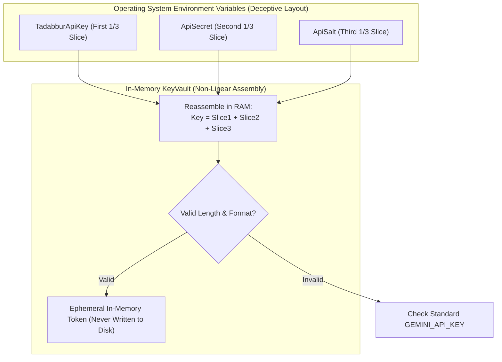

<div dir="rtl" style="text-align: right; direction: rtl;">

# 🛡️ الأمان المؤسسي والدفاع المتعمق (Enterprise Security & Defense-in-Depth)
## الدليل الأمني لمنظومة الـ RAG، عزل المستأجرين، تحصين البرومبت، وخزنة المفاتيح المموهة

---

### 1. فلسفة الأمان في أنظمة الذكاء الاصطناعي (Security Philosophy)

الأمان في أنظمة الـ RAG ليس مجرد إضافة طبقة جدار حماية (Firewall) عند المدخل، بل هو **تصميم متكامل عبر جميع طبقات النظام (Defense in Depth)**.
يتعرض نظام الـ RAG لتهديدات متقدمة وفريدة من نوعها:
1. **هجمات حقن البرومبت المباشرة وغير المباشرة (Direct & Indirect Prompt Injection):** محاولة المستخدم أو المستند المرفوع إجبار النموذج على كسر تعليمات الأمان.
2. **تسريب المفاتيح وبيانات الاعتماد (Credential Scraping):** اختراق ملفات `.env` أو مساحات التخزين السحابية واستخراج مفاتيح Gemini و OpenAI.
3. **تداخل الجلسات وتسريب المحادثات (Cross-Session Data Leakage):** قراءة مستخدم لمحادثة أو وثائق مستخدم آخر عبر ثغرات في واجهات REST.
4. **تسميم الكاش الدلالي (Semantic Cache Poisoning):** إدخال استعلام خبيث يُخزن إجابة مضللة ليتم تقديمها لاحقاً لجميع المستخدمين.

---

### 2. خزنة المفاتيح المموهة ثلاثياً (`KeyVault Deceptive Splitting`)

لحماية المفاتيح الحساسة من محركات الفحص الساكن (Static Secret Scanners مثل GitGuardian) ومن الهجمات التي تستهدف قراءة المتغيرات البيئية بصيغتها الصريحة:

</div>

<div dir="ltr" style="text-align: left; direction: ltr;">



</div>

<div dir="rtl" style="text-align: right; direction: rtl;">

- **الترتيب غير الخطي في ملف التكوين (`.env`):**
  يتم توزيع المفتاح عمداً بترتيب مضلل:
  - `TadabburApiKey` (الجزء الأول)
  - `ApiSalt` (الجزء الثالث)
  - `ApiSecret` (الجزء الثاني)
- يتم التجميع لحظياً داخل الذاكرة العشوائية (RAM) أثناء استدعاء API دون حفظ المفتاح المجمع في أي ملف على القرص.

---

### 3. تحصين البرومبت ومقاومة وسوم التجاوز (`Prompt Injection Immunity`)

1. **تجريد وسوم تحكم النماذج (Model Escape Tokens Sanitization):**
   يقوم `PromptSanitizer` بمسح واستئصال كافة وسوم التحكم الخاصة بمختلف نماذج الذكاء الاصطناعي من نصوص الاستعلامات والملفات المرفوعة:
   <div dir="ltr" style="text-align: left; direction: ltr;">
   
   ```text
   <|im_start|>, <|im_end|>, [INST], [/INST], <<SYS>>, <</SYS>>, [SYSTEM], <control_token>
   ```
   </div>
2. **التسييج المشفر بالنونس العشوائي (Cryptographic Nonce):**
   تُغلف الوثائق دائماً داخل وسوم عشوائية لا يمكن للمهاجم تخمينها:
   `<untrusted_knowledge_evidence nonce="{boundaryNonce}">`
   ويُحظر على النموذج اللغوي استلام أي أوامر تنفيذية من داخل هذه المنطقة.

---

### 4. التحكم بالوصول وعزل المستأجرين (RBAC & Tenant Isolation)

1. **التحكم بالوصول المبني على الأدوار (`Role-Based Access Control - RBAC`):**
   - `admin`: إدارة المستخدمين، اعتماد وتحديث المستندات، مسح الكاش، واستعراض سجلات التدقيق الأمني.
   - `ingestor`: رفع المستندات ومعالجتها ومتابعة حالة وظائف الاستيعاب.
   - `reader`: الاستعلام، البحث، والمحادثة في نطاق المستندات المصرح بها فقط.
2. **عزل المحادثات الصارم (Strict Conversation Isolation):**
   - كل محادثة ترتبط بـ `user_identifier` مشفر.
   - عند محاولة مستخدم إرسال رسالة في محادثة لا يملكها (حتى لو كانت معرفة بـ UUID عام)، يرفض النظام الطلب بـ `403 Forbidden` فوراً لحماية خصوصية الاستعلامات:
   <div dir="ltr" style="text-align: left; direction: ltr;">
   
   ```python
   if conv.user_identifier and conv.user_identifier != current_user_id:
       raise HTTPException(
           status_code=status.HTTP_403_FORBIDDEN,
           detail="هذه المحادثة معروضة للقراءة فقط، يرجى بدء محادثة جديدة لطرح أسئلتك."
       )
   ```
   </div>

---

### 5. تحديد المعدل الموزع وحماية الخدمة (`Distributed Rate Limiting`)

لحماية الخوادم من هجمات حرمان الخدمة (DDoS) واستنزاف أرصدة النماذج:
- استخدام خوارزمية **نافذة الانزلاق اللحظية (Sliding Window Log)** المنفذة عبر أنابيب Redis الذرية (`Redis Pipeline`).
- **الحدود الافتراضية:**
  - المستخدمون المسجلون: `120 طلب / دقيقة`.
  - الزوار غير المسجلين: `15 طلباً / دقيقة`، مع سقف يومي أقصى قدره `100 طلب / 24 ساعة`.
  - مسارات الاستيعاب والرفع: `10 ملفات / دقيقة`.

---

### 6. التحقق الصارم من الملفات المرفوعة (`Secure Upload Gate`)

لحماية النظام من الملفات الملغومة أو هجمات تجاوز سعة الذاكرة (Zip Bombs / Image Allocation Attacks):
1. **الحد الأقصى لحجم الملف:** `50 MB` لكل ملف، يتم فحصه عبر قراءة تدفق البايتات مع قطع الاتصال فور تجاوز الحد.
2. **فحص الامتدادات والبصمة السحرية (Magic Bytes):**
   - حصر الامتدادات في: `.pdf`, `.docx`, `.md`, `.txt`.
   - التحقق من ترويسة الملف بواسطة `python-magic` أو قراءة البايتات الحقيقية والتأكد من مطابقتها للامتداد المعلن.
3. **تجريد مسار الملف (Path Traversal Protection):**
   - استخدام `os.path.basename` وتوليد أسماء ملفات عشوائية باستخدام UUID4 لحفظها على القرص في مجلد معزول، مما يمنع هجمات الكتابة على ملفات النظام (`../../etc/passwd`).

---

### 7. سجل التدقيق الأمني للعمليات (`Security Audit Logging`)

يتم تسجيل جميع العمليات الإدارية الحساسة، محاولات الاختراق، وتجاوز الصلاحيات في جدول غير قابل للتعديل (`security_audit_logs`):

<div dir="ltr" style="text-align: left; direction: ltr;">

```sql
CREATE TABLE IF NOT EXISTS security_audit_logs (
    id BIGSERIAL PRIMARY KEY,
    timestamp TIMESTAMPTZ DEFAULT CURRENT_TIMESTAMP,
    actor_id VARCHAR(100) NOT NULL,
    actor_role VARCHAR(20) NOT NULL,
    action VARCHAR(100) NOT NULL,
    target_resource VARCHAR(255),
    ip_address VARCHAR(45),
    user_agent TEXT,
    details JSONB DEFAULT '{}'::jsonb
);

CREATE INDEX idx_security_audit_timestamp ON security_audit_logs ("timestamp" DESC);
CREATE INDEX idx_security_audit_actor ON security_audit_logs (actor_id);
```

</div>
